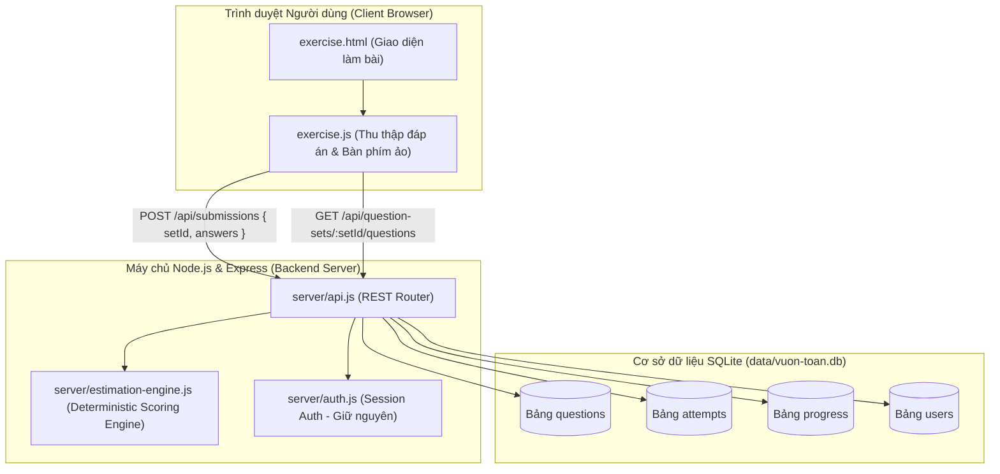
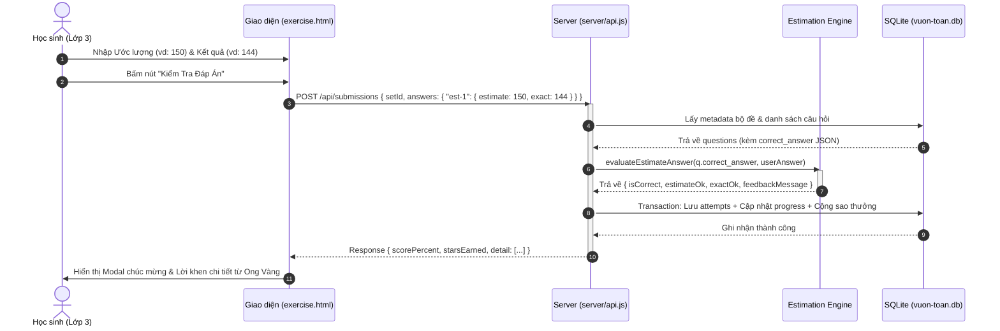

# BÁO CÁO THIẾT KẾ KIẾN TRÚC & QUYẾT ĐỊNH KỸ THUẬT (ARCHITECTURAL DECISION RECORDS)
## Dự án: Vườn Toán Lớp 3 — Dạng bài "Ước lượng trước khi tính đúng"
**Mã tài liệu**: `KTPMUD-BKT-TRACKB-DECISIONS`  
**Nhánh / Track**: Track B (Toán Tiểu Học Lớp 3)  
**Phiên bản**: `1.0.0` (Checkpoint 1)  
**Đối chiếu cơ sở**: `docs/architecture-reference.md` (Repo: `fossbk-spec/ktpmud-bkt-vuontoan-starter`)

---

## 1. Tổng quan Kiến trúc Hệ thống (System Architecture Overview)

Hệ thống "Vườn Toán Lớp 3" tuân thủ kiến trúc phân tầng cổ điển (Monolithic Layered Architecture) tối giản và hiệu quả:
- **Presentation Layer**: Trang tĩnh HTML5, CSS (Tailwind build sẵn), Vanilla JavaScript hướng sự kiện, gọi API bất đồng bộ qua `fetch()`.
- **Application / API Layer**: Node.js + Express REST API, xử lý định tuyến, xác thực cookie session và thực hiện chấm điểm tập trung.
- **Domain Service Layer (Mới mở rộng)**: `server/estimation-engine.js` — Bộ máy xử lý quy tắc toán học tất định và sinh phản hồi sư phạm.
- **Persistence Layer**: SQLite (`better-sqlite3`) lưu trữ trực tiếp trên file đĩa đơn lẻ `data/vuon-toan.db`, thực thi câu lệnh SQL đồng bộ qua prepared statements.

### Sơ đồ Kiến trúc C4 - Container Diagram

---

## 2. Các Quyết định Kiến trúc Then chốt (Architectural Decision Records)

### ADR-01: Mô hình lưu trữ dữ liệu câu hỏi ước lượng (Data Model Evolution)
- **Bối cảnh**:
  Hệ thống hiện tại có bảng `questions` với cấu trúc `correct_answer TEXT`. Đối với 4 dạng bài cũ (`multiple-choice`, `input`, `compare`, `paint`), trường này chỉ lưu 1 chuỗi đơn lẻ (ví dụ `"42"` hoặc `"="`). Dạng bài mới "Ước lượng trước khi tính đúng" đòi hỏi phải lưu cả 2 thông tin: giá trị ước lượng hợp lý và kết quả tính chính xác.
- **Các phương án cân nhắc**:
  1. *Phương án A — Sửa Schema SQLite*: Thêm cột `estimate_answer TEXT` và `exact_answer TEXT` vào bảng `questions`.
     - *Ưu điểm*: Cột dữ liệu tường minh.
     - *Nhược điểm*: Phá vỡ tính tương thích ngược, đòi hỏi migration script khi khởi tạo DB cũ, gây phức tạp cho các API dùng chung và công cụ nạp dữ liệu `data/seed.json`.
  2. *Phương án B (Được chọn) — Đóng gói JSON trong `correct_answer`*: Lưu chuỗi JSON chuẩn hóa vào cột `correct_answer TEXT` hiện có với `type = 'estimate'`.
     - Cấu trúc: `{"estimate": 150, "exact": 144, "formula": "48 × 3", "roundedFormula": "50 × 3 = 150", "explanation": "..."}`.
     - *Ưu điểm*:
       - Giữ nguyên $100\%$ schema SQLite, rủi ro migration bằng $0$.
       - Dễ dàng mở rộng thêm trường sư phạm (công thức làm tròn, lời giải thích chi tiết của Ong Vàng) mà không cần chỉnh sửa DB schema.
       - Tương thích $100\%$ với các bộ câu hỏi cũ.
- **Hệ quả & Giải pháp**: Ứng dụng cần parse JSON an toàn bằng try-catch tại tầng Application (`server/estimation-engine.js`).

---

### ADR-02: Cơ chế chấm điểm và phân tách trách nhiệm (Server-Side Scoring & Security)
- **Bối cảnh**:
  Yêu cầu bài toán đòi hỏi bảo mật (B-04: API không trả đáp án đúng trước khi nộp) và toàn vẹn (B-05: Server chấm và lưu kết quả bền vững).
- **Quyết định**:
  1. Giữ nguyên nguyên tắc endpoint `GET /api/question-sets/:setId/questions` chỉ truy vấn các trường công khai (`id, type, prompt, options_json, points, category`), tuyệt đối không select `correct_answer`.
  2. Toàn bộ logic chấm điểm và tính sao thưởng thực thi tập trung tại route `POST /api/submissions` trên server.
  3. Gói gọn quá trình ghi lịch sử (`attempts`), cập nhật tiến độ học tập (`progress`) và cộng sao tích lũy (`users.total_stars`) trong một SQLite Transaction (`db.transaction`) đồng bộ, bảo đảm tính ACID và chống race conditions.
- **Lợi ích**:
  - Triệt tiêu hoàn toàn khả năng can thiệp gian lận từ phía client.
  - Đảm bảo tính nhất quán của dữ liệu điểm số và bảng xếp hạng (Leaderboard).

---

### ADR-03: Tính toán tất định & Thuật toán Sư phạm (Deterministic Math Rules)
- **Bối cảnh**:
  Tiêu chí B-03 yêu cầu quy tắc tạo và chấm ước lượng phải rõ ràng, tất định và kiểm thử được; không sử dụng mô hình AI (LLM) để sinh đáp án runtime.
- **Quyết định**:
  Hiện thực hóa module độc lập `server/estimation-engine.js` với các hàm thuần túy (pure functions):
  1. `roundToNearestTen(num)`: Làm tròn số tự nhiên về hàng chục gần nhất theo chuẩn toán học:
     $$\text{roundToNearestTen}(n) = \left\lfloor \frac{n + 5}{10} \right\rfloor \times 10$$
     - Ví dụ: $48 \rightarrow 50$, $23 \rightarrow 20$, trường hợp biên $45 \rightarrow 50$.
  2. `evaluateEstimateAnswer(correctAnswerField, rawStudentAnswer)`:
     - Phân tích độc lập 2 thành phần: `estimateOk` (học sinh đoán đúng giá trị ước lượng nhẩm) và `exactOk` (học sinh tính đúng kết quả chính xác).
     - Điểm câu hỏi chỉ được tính trọn vẹn khi cả hai bước đều hoàn thành chính xác (`isCorrect = estimateOk && exactOk`).
     - Trả về phản hồi sư phạm phân biệt rõ ràng (đáp ứng tiêu chí B-06) nhằm khuyến khích tư duy học sinh thay vì chỉ báo đúng/sai đơn điệu.

---

### ADR-04: Chiến lược kiểm thử tự động (Testing Strategy & CI Pipeline)
- **Bối cảnh**:
  Starter repo ban đầu chưa có lệnh `npm test` (B-09) và chưa có CI (B-10).
- **Quyết định**:
  1. Sử dụng trực tiếp **Node.js Test Runner** (`node:test` và `node:assert/strict`) tích hợp sẵn trong Node.js 18+.
     - *Lý do chọn*: Không cần cài thêm dependencies bên ngoài (như Jest hay Mocha), giúp việc checkout sạch (`clean checkout`) và cài đặt `npm ci` diễn ra nhanh gấp nhiều lần, loại bỏ nguy cơ xung đột phiên bản.
  2. Cấu trúc bộ test:
     - `test/estimation-engine.test.js`: Unit tests bao phủ các ca thông thường, ca biên (số kết thúc bằng 5), chuỗi rác, null/undefined, và các kịch bản kết quả (đúng cả 2, đúng 1 trong 2, sai cả 2).
     - `test/integration.test.js`: Integration tests sử dụng in-memory SQLite database để mô phỏng trọn vẹn luồng nộp bài, tính sao tiến bộ, kiểm tra không rò rỉ đáp án (B-04) và lưu trữ bền vững (B-05).
  3. CI Pipeline: Tích hợp GitHub Actions `.github/workflows/ci.yml` chạy trên cả Node.js 18.x và 20.x mỗi khi có sự kiện Push hoặc Pull Request vào nhánh chính.

---

## 3. Sơ đồ Tuần tự Luồng Nộp bài & Chấm điểm (Sequence Diagram)

---

## 4. Kế hoạch Bàn giao & Bảo trì (Maintainability & Handoff)

1. **Khả năng mở rộng**:
   - Để thêm các câu hỏi ước lượng mới, giáo viên hoặc nhóm kỹ thuật chỉ cần thêm một bản ghi vào mảng `questions` trong `data/seed.json` với `type: "estimate"` và chuỗi `correctAnswer` theo format JSON quy định. Hệ thống tự động nạp vào DB khi reset.
2. **Quy tắc An toàn Dữ liệu (Safety Boundaries)**:
   - Toàn bộ dữ liệu trong hệ thống là dữ liệu synthetic mô phỏng.
   - Không chứa bất kỳ thông tin nhận dạng cá nhân (PII) hay thông tin y tế nhạy cảm nào.
